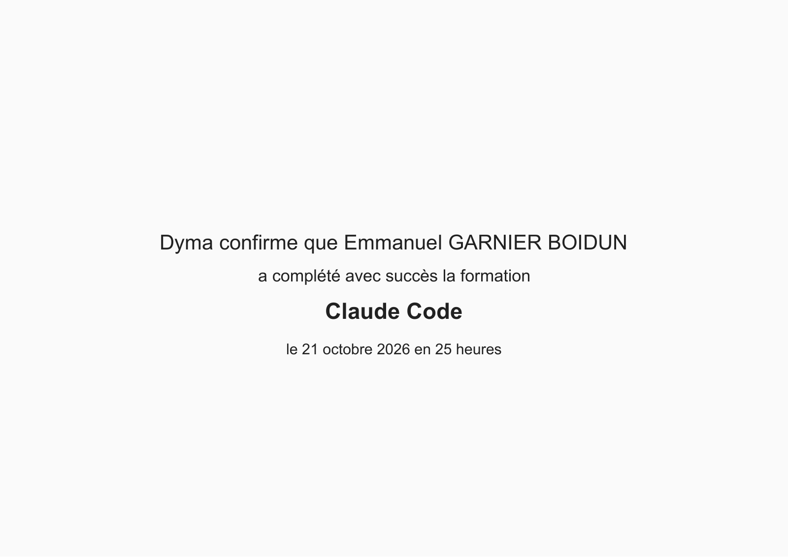

# JobView

<p align="center">
  
</p>
<p align="center">
  📄 <a href="./assets/certification-claude-code.pdf">Consulter le certificat officiel au format PDF</a>
</p>

> **Formation Claude Code validée le 21 octobre 2026 (25 heures de formation).**

Une application Angular pour conserver ses entretiens et comparer les propositions d’emploi. Le périmètre est décrit dans [design-doc.md](design-doc.md).

## Prérequis et commandes

- Node.js **24.18.1**, indiqué dans `.node-version` (minimum 24.15, branche 24).
- pnpm **10.15.1**, indiqué dans `package.json`.

Avec Corepack disponible, exécuter `corepack enable` si nécessaire. Sinon, installer pnpm 10.15.1.

```sh
pnpm install --frozen-lockfile
pnpm dev
pnpm test
pnpm build
```

`pnpm dev` lance le serveur sur `http://localhost:4200`. Les tests s’exécutent sans surveillance. La compilation de production génère le site statique dans `dist/jobview/browser/`.

## Organisation

Une seule application, avec ses sources dans `src/` et sa configuration à la racine. Aucun CLI ni package partagé n’est nécessaire.

Les futurs écrans, types métier et service de stockage seront ajoutés dans `src/app/` au fil des fonctionnalités. Les composants passeront par un seul service pour accéder à localStorage, sans multiplier les couches ou les abstractions.

Les versions directes sont exactes et `pnpm-lock.yaml` verrouille les dépendances transitives. `.npmrc` conserve une installation à plat adaptée aux contraintes Windows et un cache local ignoré par Git. Seul le script d’installation d’esbuild est autorisé, dans la configuration `pnpm` de `package.json`.

## État actuel

L'interface affiche uniquement « JobView ». Les modèles et validations métier (phase 1) et le service de persistance locale protégée (phase 2) sont implémentés et vérifiés localement : 270 tests, compilation et vérification TypeScript réussis. Les [preuves par phase](docs/phases/README.md) détaillent ces contrôles. La prochaine étape est le parcours Angular profil → création d'un entretien → sauvegarde (phase 3), puis la recette avec réouverture réelle du navigateur (phase 4). Le déploiement reste à réaliser.

Pour Vercel, utiliser la racine du projet, Node.js 24 compatible avec les moteurs déclarés, pnpm 10.15.1, la commande `pnpm build` et le répertoire de sortie `dist/jobview/browser/`. Le déploiement et le maintien d’une adresse stable restent à valider. La licence reste à choisir avant diffusion.
